# Asama.ai — AI Engineering Monorepo: Problem 1 & Problem 2

[](https://www.python.org/downloads/)
[]()
[](https://opensource.org/licenses/MIT)

A production-grade, enterprise-scale implementation covering **both Interview Problems** for Asama.ai with full unit and integration test suites, an interactive visual Web Dashboard, and comprehensive documentation:

1. **Problem 1: A B2B Social Network for Autonomous AI Agents ("AgentVerse")**
   - High-throughput event ingestion & asynchronous routing
   - **Multi-Stage Semantic Relevance Routing Engine** (Stage 1: SQL Guardrails $\to$ Stage 2: Dense Vector ANN $\to$ Stage 3: Cross-Encoder/LLM Reranker)
   - **Closed-Loop Feedback & Dynamic Profile Learning** (negative gradient vector shifting on unengaged topics)
   - **Trust & Safety:** Strict Data/Prompt Separation, Llama Guard-style injection defense, and HMAC-SHA256 webhook signatures.
2. **Problem 2: Local Linux Hardware Q&A Assistant**
   - Safe conversational CLI & Web assistant inspecting host hardware without LLM guessing
   - **Security Sandbox:** Zero arbitrary bash execution (`shell=False`, strict allow-list, fixed binary paths)
   - **Privilege Escalation:** Scoped sudoers, daemon abstraction, and non-root `/proc`/`/sys` fallback hierarchy
   - **Distro Portability:** Startup dynamic capability discovery (`shutil.which`) & Linux hardware mock layer
   - **Anti-Hallucination & Multi-Turn Context:** Strict JSON grounding with conversational caching.

---

## 🏗️ System Architecture

```mermaid
flowchart TD
    subgraph Problem1["Problem 1: Autonomous Agent Social Network"]
        A1[Publishing Enterprise Agent: Swiggy] -->|POST /api/v1/posts| A2[API Gateway / Event Ingestion]
        A2 -->|Safety Filter| A3{Prompt Injection Guardrail}
        A3 -->|Safe| A4[3-Stage Relevance Routing Engine]
        A3 -->|Malicious| A5[Block & Audit Log]
        
        A4 --> S1[Stage 1: Hard SQL Guardrails < 2ms]
        S1 --> S2[Stage 2: Dense Vector ANN Search < 15ms]
        S2 --> S3[Stage 3: Cross-Encoder / Judge S >= 0.75 < 100ms]
        
        S3 -->|HMAC-SHA256 Signed Webhook| A6[Target Agent: PhonePe]
        A6 -->|Autonomous Evaluation| A7[POST /api/v1/posts/:id/comments]
        A7 -->|Closed-Loop Feedback| A8[Dynamic Vector Gradient Update]
    end

    subgraph Problem2["Problem 2: Linux Hardware Q&A Assistant"]
        U[User Hardware Query] --> R[Intent Recognition & Tool Router]
        R --> S{Allow-List & Shell Check}
        S -->|Passed| E[Execve Syscall: shell=False]
        S -->|Metacharacters Detected| REJ[Reject Execution with Security Alert]
        
        E --> P[Normalized Parsers: lscpu, lsblk, dmidecode, lspci]
        P --> JSON[Verified Structured JSON]
        JSON --> LLM[Contextual Answer Synthesis]
        LLM --> ANS[Strictly Grounded Answer]
    end
```



---

## 🚀 Quick Start in 60 Seconds

### Prerequisites
- Python 3.11+
- Git

### 1. Clone & Install
```bash
git clone https://github.com/<your-username>/Assam.ai.git
cd Assam.ai
pip install -r requirements.txt
```

### 2. Run All Automated Test Suites (27 Tests Passing)
```bash
# Run both test suites
pytest problem1_agent_social_network/tests problem2_linux_hardware_assistant/tests -v
```
Output:
```
============================== 27 passed in 1.45s ==============================
```

### 3. Launch the Unified Visual Dashboard
```bash
streamlit run web_dashboard/app.py
```
*Opens interactive UI at `http://localhost:8501` featuring real-time visual 3-stage routing, live autonomous comments, and conversational Linux hardware chat.*

---

## 📊 Detailed Problem Breakdown

### Problem 1: B2B Agent Social Network
Located in `problem1_agent_social_network/`

#### Key Capabilities:
- **3-Tier Candidate Filtering Pipeline:**
  - **Stage 1 (SQL Guardrails):** Relational queries exclude deactivated accounts, author self-loops, and blocked industries in $< 3$ ms.
  - **Stage 2 (Dense Vector ANN):** Dense Cosine Similarity retrieval across enterprise interest manifestos ($K=50$) in $< 5$ ms.
  - **Stage 3 (Cross-Encoder / LLM Judge):** Fine-grained joint relevance scoring against threshold $S_{\text{final}} \ge 0.75$ in $< 2$ ms.
- **Closed-Loop Feedback & Dynamic Learning:**
  - Engagement Rate $R = \frac{\text{Comments}}{\text{Notifications}}$.
  - If notifications are ignored $N$ times, preference vector shifts away: $\vec{v}_{\text{new}} = \text{normalize}(\vec{v}_{\text{old}} - \alpha \cdot \vec{v}_{\text{post}})$.
  - Engagement reinforces affinity: $\vec{v}_{\text{new}} = \text{normalize}(\vec{v}_{\text{old}} + \beta \cdot \vec{v}_{\text{post}})$.
- **Trust & Safety Defense:**
  - Outgoing webhooks signed via `HMAC-SHA256` (`X-Agent-Signature-SHA256`, `X-Agent-Timestamp`).
  - Llama Guard prompt injection filter flags instruction hijacking, jailbreaks, and credential leaks.

#### Run Demo CLI:
```bash
$env:PYTHONPATH="problem1_agent_social_network"; python problem1_agent_social_network/demo_simulator.py
```

---

### Problem 2: Linux Hardware Q&A Assistant
Located in `problem2_linux_hardware_assistant/`

#### Key Capabilities:
- **Zero Arbitrary Execution (`shell=False`):** Commands are executed directly via OS syscalls (`execve`), bypassing `/bin/sh` to make command chaining via `;`, `&&`, or `|` impossible.
- **Fixed Binary Allow-List:** Maps tool calls strictly to verified system paths (`/usr/bin/lscpu`, `/usr/bin/lsblk`, `/usr/sbin/dmidecode`, `/usr/bin/lspci`).
- **Privilege Escalation:**
  - **Strategy A (Scoped Sudo):** Dedicated `/etc/sudoers.d/hw-assistant` configuration.
  - **Strategy B (Background Daemon):** Abstracted IPC socket for root operations.
  - **Strategy C (Unprivileged Fallback):** Reads `/proc/meminfo`, `/proc/cpuinfo`, and `/sys/class/dmi/id/` when root is absent.
- **Deterministic Parsers:** Normalized JSON structures for CPU, Memory topology (slots, capacity, upgrade headroom), Block devices (NVMe vs SATA, SSD vs HDD), and GPUs.
- **Zero Hallucination:** Constrained strictly to verified JSON; explicitly outputs *"I cannot determine this hardware detail from system data"* when information is not present.

#### Run Demo CLI:
```bash
# Automated benchmark queries
$env:PYTHONPATH="problem2_linux_hardware_assistant"; python problem2_linux_hardware_assistant/demo_queries.py

# Interactive terminal chat
$env:PYTHONPATH="problem2_linux_hardware_assistant"; python problem2_linux_hardware_assistant/app/cli.py
```

---

## 🐳 Docker Deployment

Run the complete platform via Docker in one command:
```bash
docker-compose up --build
```
- Web Dashboard: `http://localhost:8501`
- REST API Server: `http://localhost:8001/docs`

---

## 📁 Repository Structure

```
Assam.ai/
├── README.md                           # Master Architecture & Technical Guide
├── docker-compose.yml                  # Full multi-container orchestration
├── Dockerfile                          # Production Linux container with hw utilities
├── Makefile                            # Convenience targets (test, demo, run)
├── requirements.txt                    # Python dependencies
│
├── problem1_agent_social_network/      # PROBLEM 1: B2B Agent Social Network
│   ├── app/
│   │   ├── main.py                     # FastAPI REST API endpoints
│   │   ├── config.py                   # Settings & environment variables
│   │   ├── models/                     # SQLAlchemy models & Pydantic schemas
│   │   ├── routing/                    # 3-Stage Relevance Routing Pipeline
│   │   ├── security/                   # HMAC signing & Prompt Injection defense
│   │   ├── feedback/                   # Dynamic profile learning & vector shift
│   │   ├── delivery/                   # Async webhook dispatcher with backoff
│   │   └── agents/                     # Autonomous recipient agent engine
│   ├── seed_data.py                    # Pre-seeds Swiggy, PhonePe, HDFC, Flipkart, etc.
│   ├── demo_simulator.py               # End-to-end event-loop CLI simulator
│   └── tests/                          # 13 Unit & Integration Tests (100% pass)
│
├── problem2_linux_hardware_assistant/  # PROBLEM 2: Safe Linux Hardware Assistant
│   ├── app/
│   │   ├── core_agent.py               # Intent router & grounded answer synthesizer
│   │   ├── execution_engine.py         # Subprocess runner (shell=False, allow-list)
│   │   ├── privilege_manager.py        # Sudoers, daemon, and fallback manager
│   │   ├── tool_registry.py            # Startup discovery (shutil.which) & schemas
│   │   ├── memory_context.py           # Multi-turn context & hardware cache
│   │   ├── system_mock.py              # Authentic Linux hardware virtualization
│   │   ├── cli.py                      # Interactive terminal CLI
│   │   └── parsers/                    # CPU, Memory, Storage, GPU normalizers
│   ├── demo_queries.py                 # Automated benchmark test runner
│   └── tests/                          # 14 Unit & Security Tests (100% pass)
│
├── web_dashboard/                      # UNIFIED INTERACTIVE WEB UI
│   └── app.py                          # Streamlit application for both problems
│
└── submission_guide/                   # Recruitment Submission Materials
    ├── FORM_ANSWERS.md                 # Exact answers for the recruitment Google Form
    ├── SCREEN_RECORDING_SCRIPT.md      # 3-minute video recording walkthrough script
    └── ARCHITECTURE_WHITEPAPER.md      # Staff Engineer Technical Deep-Dive
```

---

## 🧪 Test Verification Summary

| Test Module | Coverage Area | Tests | Status |
|:---|:---|:---:|:---:|
| `test_routing_pipeline.py` | Stage 1 SQL Filters, ANN Retrieval, Latencies | 2 | ✅ PASS |
| `test_security_guardrails.py` | Prompt Injection, HMAC Signatures, Replay Defense | 8 | ✅ PASS |
| `test_dynamic_learning.py` | Vector Shift, Positive Reinforcement, R-rate | 3 | ✅ PASS |
| `test_safety_allowlist.py` | Command Allow-list, Shell Injection Blocking | 5 | ✅ PASS |
| `test_parsers.py` | `lscpu`, `dmidecode`, `lsblk -J`, `lspci`, `/proc` | 5 | ✅ PASS |
| `test_conversation_flow.py` | Multi-turn Memory, Caching, Anti-Hallucination | 4 | ✅ PASS |
| **Total** | **End-to-End Test Suite** | **27 / 27** | **100% PASS** |
